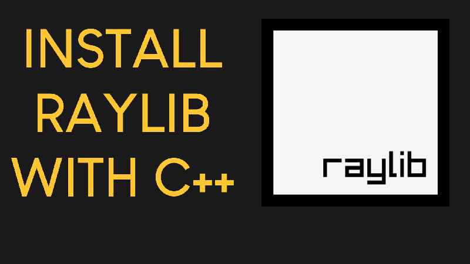

<h1 align="center">
  
  <br>
  PACMAN
  <br>
  <sub>A Pac-Man inspired arcade game in C++ with raylib</sub>
</h1>

<p align="center">
  <a href="https://github.com/redsteadz/PACMAN/releases/latest"></a>
  <a href="https://github.com/redsteadz/PACMAN/releases"></a>
  <a href="https://github.com/redsteadz/PACMAN/actions"></a>
  
</p>

<p align="center">
  <b><a href="#-download">Download</a></b> &nbsp;&middot;&nbsp;
  <a href="#-controls">Controls</a> &nbsp;&middot;&nbsp;
  <a href="#-features">Features</a> &nbsp;&middot;&nbsp;
  <a href="#-building-from-source">Build it</a> &nbsp;&middot;&nbsp;
  <a href="https://github.com/redsteadz/PuzzledChess/releases">PuzzledChess</a>
</p>

---

## 📥 Download

Ready-to-play builds for both platforms. No install, no build tools, no extra
runtime libraries &mdash; unzip the archive, keep the `assets` folder next to
the executable, and run it.

| Platform | File | Requirements |
| --- | --- | --- |
| **Windows** | [`PACMAN-windows-x86_64.zip`](https://github.com/redsteadz/PACMAN/releases/latest/download/PACMAN-windows-x86_64.zip) | Windows 10+, 64-bit |
| **Linux** | [`PACMAN-linux-x86_64.tar.gz`](https://github.com/redsteadz/PACMAN/releases/latest/download/PACMAN-linux-x86_64.tar.gz) | glibc distro, OpenGL, X11 |

```bash
# Linux
tar -xzf PACMAN-linux-x86_64.tar.gz
cd PACMAN-linux-x86_64
./Pacman
```

On Windows, unzip `PACMAN-windows-x86_64.zip` and double-click `Pacman.exe`.
Both bundles unpack into a single folder with `Pacman` and `assets/` side by
side — run the game from that folder and keep the two together.

raylib is statically linked into both builds, so nothing needs installing
alongside them. Every push to `main` is compiled for both platforms, and every
tagged release publishes both archives with SHA256 checksums.

👉 **[Full download page with system requirements →](https://redsteadz.github.io/PACMAN/)**

---

## 🎮 Controls

| Input | Action |
| --- | --- |
| `W` `A` `S` `D` | Change Pac-Man's direction |
| `Space` | Movement boost (limited use) |
| Pause button | Pause or resume the simulation |
| Edit button | Open the map editor |

Inside the editor, the left mouse button paints tiles, the right mouse button
erases them, and the save and load buttons store your layout as a `.bin` file in
the `assets` folder.

---

## ✨ Features

**Ghost AI**

- Four ghosts, each with its own targeting behaviour
- Blinky homes in on your position, Pinky aims four tiles ahead of you, Inky
  trails four tiles behind, and Clyde bolts for his corner once he gets within
  four tiles
- Randomly alternating chase and scatter phases, a frightened state with a
  countdown timer after a power pellet, and a distinct Eaten state for the trip
  back to the house

**Gameplay**

- Pellets, power pellets, score, extra lives and a win screen
- Grid movement with cornering, buffering and a limited movement boost
- Pause support, background music and sound effects

**Presentation**

- Animated movement and particle effects for the boost dash and ghost hits
- Sprite-sheet driven animations loaded straight from `assets/effects`

**Map editor**

- Built into the game, reachable from the pause screen
- Load and save binary map layouts, then play them immediately

---

## 🛠️ Building from source

You need a C++ compiler, CMake 3.16+ and raylib 5.x. If you would rather not
install raylib yourself, pass `-DPACMAN_USE_BUNDLED_RAYLIB=ON` and CMake will
fetch and compile a pinned copy for you.

```bash
git clone https://github.com/redsteadz/PACMAN.git
cd PACMAN
cmake -S . -B build -DCMAKE_BUILD_TYPE=Release
cmake --build build -j
./build/bin/Pacman
```

<details>
<summary><b>Installing raylib</b></summary>

```bash
# Arch / CachyOS
sudo pacman -S cmake raylib

# Debian / Ubuntu
sudo apt install build-essential cmake libraylib-dev

# macOS
brew install cmake raylib
```

</details>

<details>
<summary><b>Cross-compiling a Windows build from Linux</b></summary>

The repository ships a MinGW-w64 toolchain file. Install the cross compiler,
point CMake at it, and add `PACMAN_STATIC_RUNTIME` to get a standalone `.exe`
with no DLLs to ship next to it.

```bash
sudo apt install g++-mingw-w64-x86-64

cmake -S . -B build \
      -DCMAKE_TOOLCHAIN_FILE=cmake/toolchain-mingw-x86_64.cmake \
      -DPACMAN_STATIC_RUNTIME=ON
cmake --build build -j
```

</details>

<details>
<summary><b>Useful CMake options</b></summary>

| Option | Default | What it does |
| --- | --- | --- |
| `CMAKE_BUILD_TYPE` | `Release` | `Debug` builds with symbols and no optimisation |
| `PACMAN_USE_BUNDLED_RAYLIB` | `OFF` | Compile a pinned raylib from source |
| `RAYLIB_GIT_TAG` | `5.5` | Which raylib tag to build |
| `PACMAN_STATIC_RUNTIME` | `OFF` | Fully static executable (MinGW) |

</details>

---

## 📁 Project layout

```
main.cpp              Game loop, grid movement, ghost AI, map handling
headers/
  animate.h           Animation manager and sprite/effect animations
  effects.h           Particle effect definitions
  gui.h               Buttons, text boxes and the map editor widgets
  raylib_compat.h     Keeps the raylib 4.x call style working on raylib 5.x
assets/               Textures, sounds, effects and the default map
docs/                 Download page published through GitHub Pages
scripts/, cmake/      Build tooling
```

---

## 📄 Credits & license

Built with [raylib](https://www.raylib.com/) and
[raymath](https://github.com/raysan5/raylib/tree/master/src) by
[raysan5](https://github.com/raysan5/raylib). The in-game widgets are a small
custom raygui-style layer in `headers/gui.h`.

This project is a personal game project and learning playground rather than a
production Pac-Man implementation. Original Pac-Man is a trademark of Bandai
Namco Entertainment.